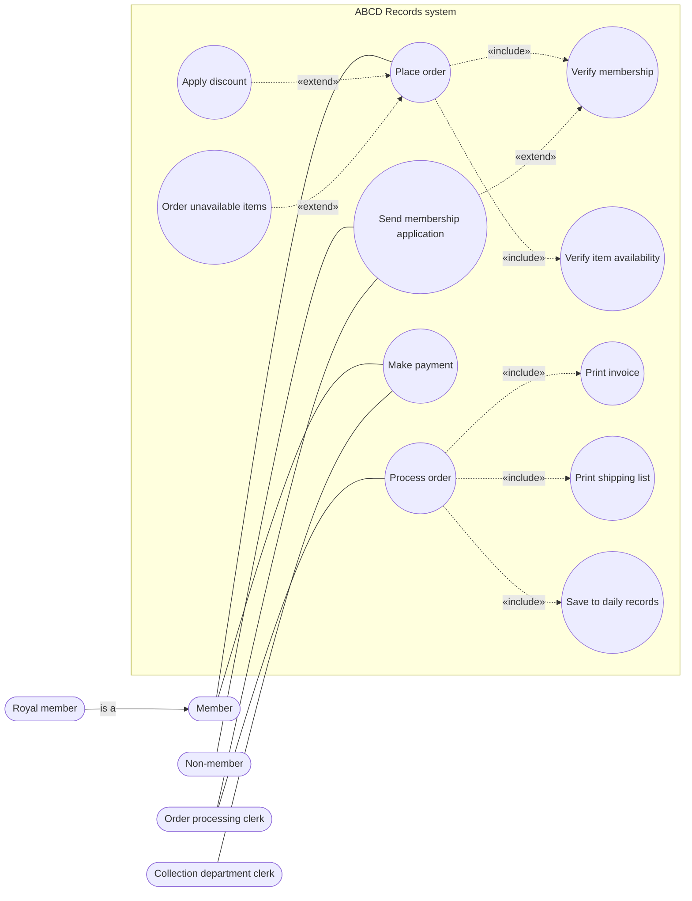
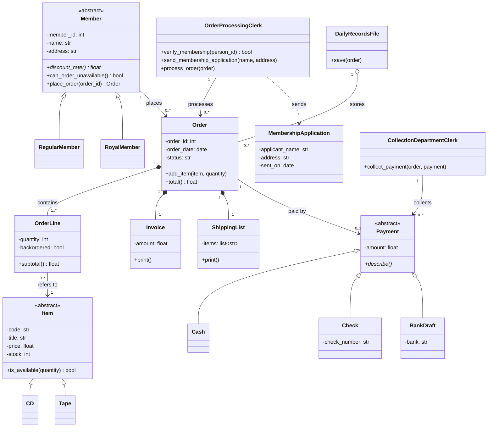
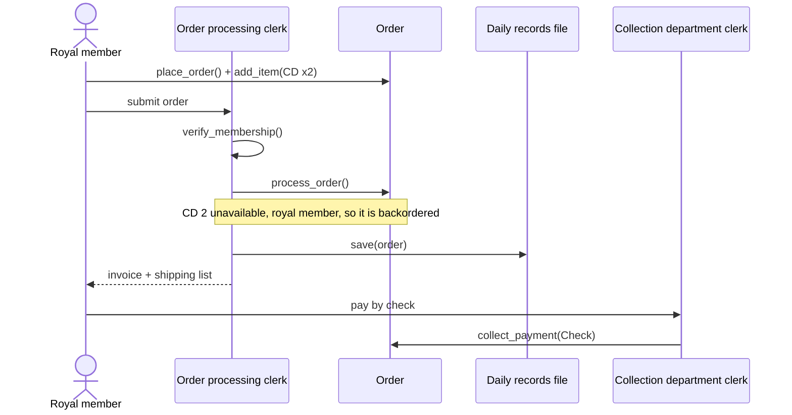

# ABCD Records

A mail-order company sells CDs and tapes. Only members can order: non-members receive a membership application. Royal members get discounts and priority and can order unavailable items; regular members cannot. Members pay by cash, check or bank draft. An order processing clerk verifies and processes orders, a collection department clerk handles payments, and every order is saved to a daily records file.

## Use case diagram



- **Include** (always happens): placing an order always verifies membership and availability; processing an order always prints the invoice and the shipping list and saves the order.
- **Extend** (happens only sometimes): the discount and ordering unavailable items only apply to royal members; the membership application is only sent when the membership check fails. The arrow points from the optional use case to the base one.
- **Actor generalization**: a royal member is a member, so it can do everything a member does.

## Class diagram



## Design choices

- **Composition**: order lines, the invoice and the shipping list do not exist without their order.
- **Aggregation**: the daily records file stores orders, but an order exists on its own.
- **OrderLine** sits between `Order` and `Item` because one order holds several items, each with its own quantity, and the same item appears in many orders.
- **Inheritance + polymorphism**: `RoyalMember` overrides `discount_rate()` and `can_order_unavailable()`, so the clerk never needs an `if member is royal` test.

## Scenario: a royal member orders two CDs (one unavailable) and pays by check



## Run

```bash
python3 abcd_records.py
```
