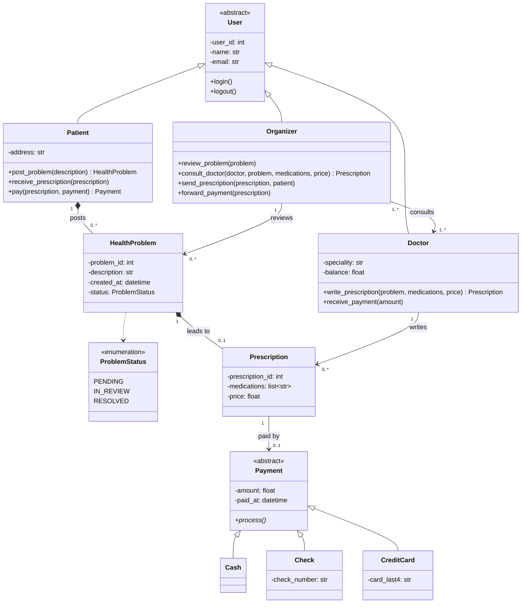
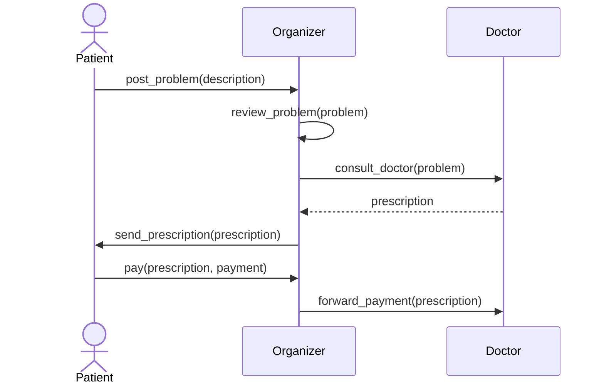

# Hospital management system

Patients post health problems online. The organizer (also the administrator) reviews each problem and consults a doctor, the doctor writes a prescription, the organizer sends it to the patient, the patient pays (cash, check or credit card) and the organizer forwards the payment to the doctor.

## Class diagram



## Design choices

- **Inheritance**: `Patient`, `Doctor` and `Organizer` share id, name, email, login and logout, so they inherit from an abstract `User`.
- **Composition** (filled diamond): a `HealthProblem` cannot exist without its `Patient`, and a `Prescription` cannot exist without the `HealthProblem` it answers.
- **Association**: a `Doctor` writes prescriptions and an `Organizer` reviews problems, but both exist independently.
- **Payment types**: `Payment` is an abstract class with an abstract `process()` method. `Cash`, `Check` and `CreditCard` each implement it. This is polymorphism, and the Strategy pattern: the patient pays the same way whatever the method.
- **Status**: an enumeration tracks each problem (pending, in-review, resolved).

## Sequence diagram: from problem to payment



## Run

```bash
python3 hospital.py
```
