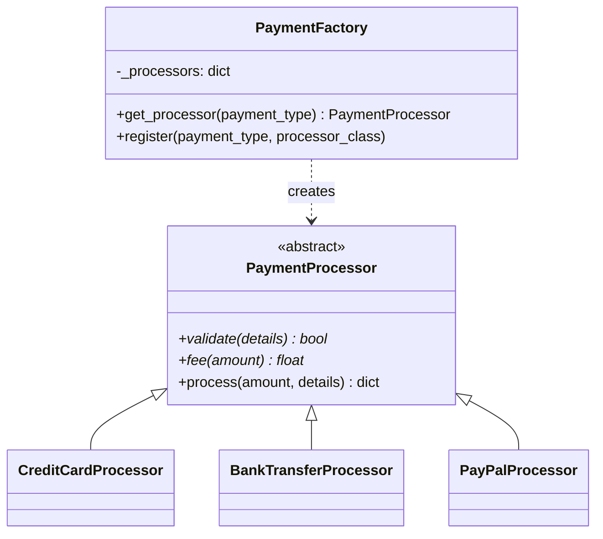
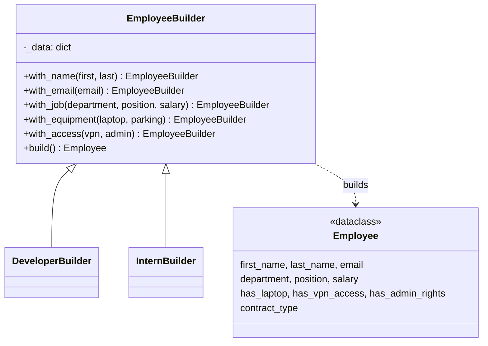
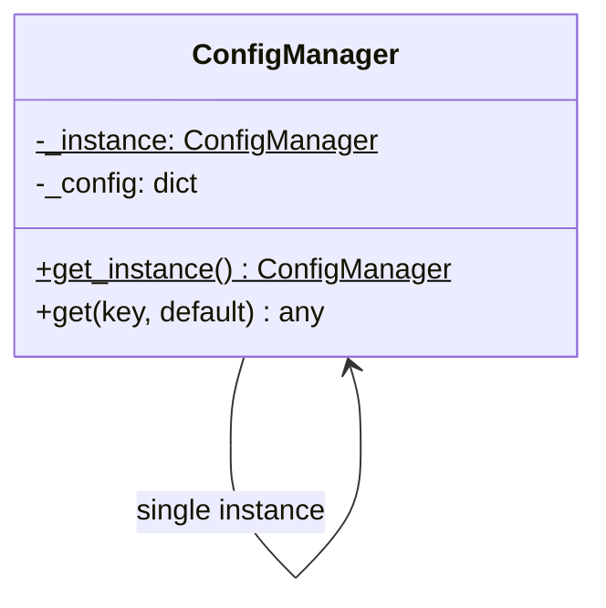
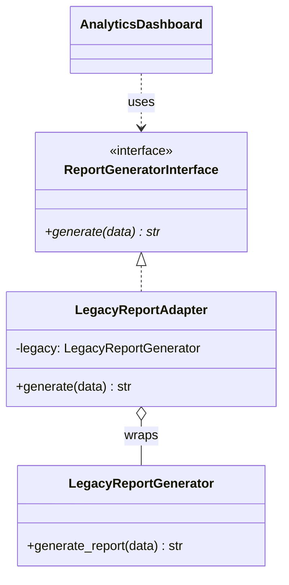
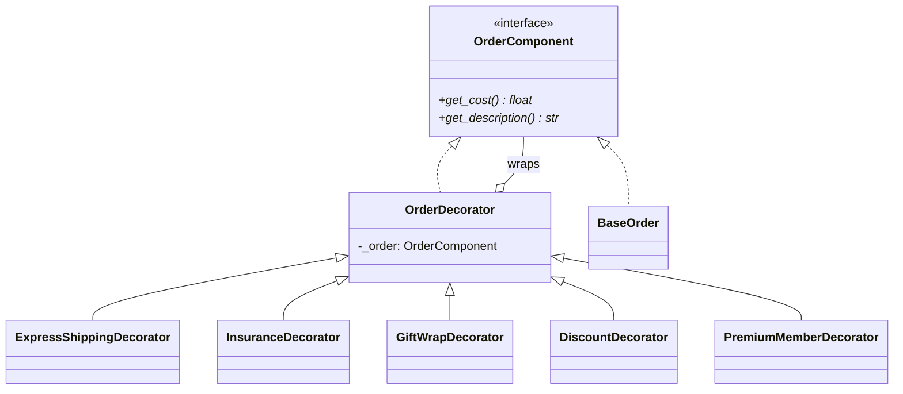
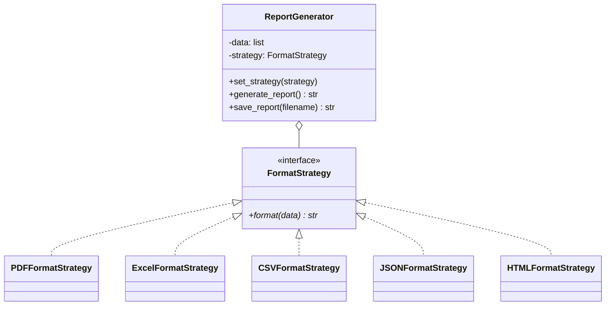
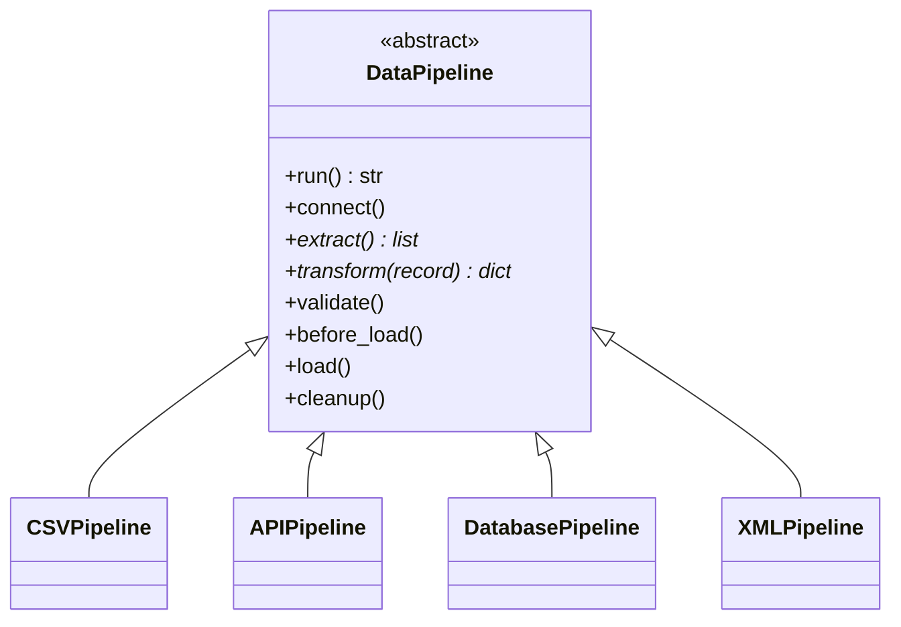

# 05-design-patterns (slide 84)

Refactoring exercises from the course pages: each "spaghetti" script is rewritten with a design pattern. Every file runs on its own with `python3 <file>.py`.

| Family | Pattern | File | Problem it solves |
|---|---|---|---|
| Creational | Factory | [`creational/factory_payment.py`](creational/factory_payment.py) | `if/elif` chain on the payment type |
| Creational | Builder | [`creational/builder_employee.py`](creational/builder_employee.py) | constructor with 17 positional parameters |
| Creational | Singleton | [`creational/singleton_config.py`](creational/singleton_config.py) | config file read again in every module |
| Structural | Adapter | [`structural/adapter_report.py`](structural/adapter_report.py) | legacy XML output, dashboard expects JSON |
| Structural | Decorator | [`structural/decorator_order.py`](structural/decorator_order.py) | explosion of boolean pricing options |
| Behavioral | Strategy | [`behavioral/strategy_report.py`](behavioral/strategy_report.py) | `if/elif` chain on the report format |
| Behavioral | Template method | [`behavioral/template_method_etl.py`](behavioral/template_method_etl.py) | three ETL pipelines duplicating the same workflow |

## Factory

A new payment method is one new class registered in the factory: `process_payment` is never reopened (open/closed principle).

## Builder

Chainable methods each return `self`, validation happens once in `build()`, and presets (`DeveloperBuilder`, `InternBuilder`) encode business rules such as "a senior developer gets admin rights".

## Singleton

`get_instance()` loads `config.json` on the first call and returns the same object afterwards; `get("database.host")` reads nested keys.

## Adapter

The legacy library is not modified: the adapter wraps it, converts its XML to JSON and exposes the interface the dashboard expects.

## Decorator

Each option wraps the order and adds its own cost and description, so options can be combined freely and new ones added without touching `BaseOrder`.

## Strategy

The report generator delegates formatting to a strategy object that can be swapped at runtime. HTML was added without modifying any existing class.

## Template method

`run()` fixes the workflow once (connect, extract, transform, validate, load, cleanup). Subclasses only implement `extract` and `transform`, and may override the `before_load` hook. The XML pipeline was added the same way.

